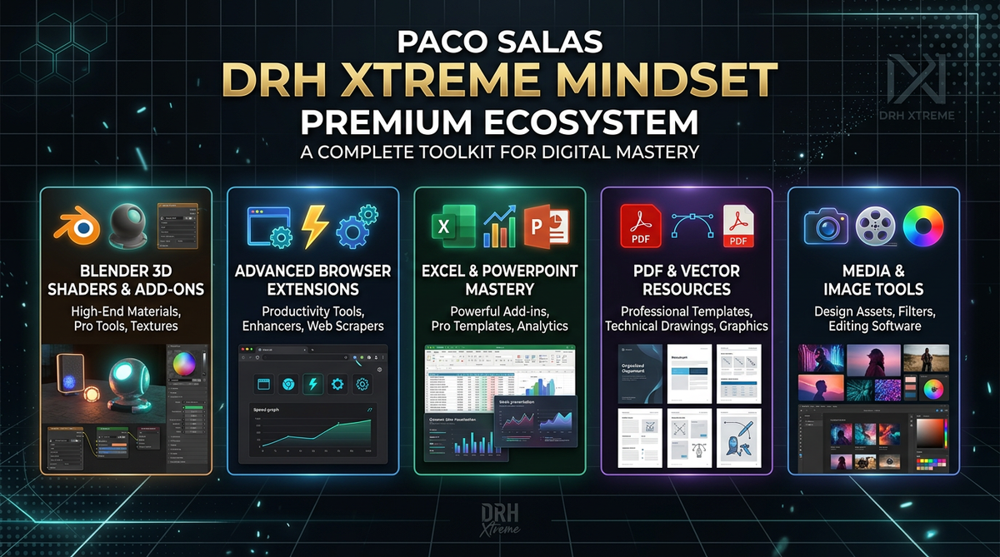

# Paco Salas · DRH · Xtreme Mindset

**I build the tool that removes the step you keep repeating.** Blender add-ons, browser extensions, Office ribbons, image utilities. Mexico.

## Start here

| You came for | Open |
|---|---|
| A Blender add-on | [The six add-ons on BlendKit](https://www.blendkit.com/?query=category_subtree:addon+author_id:205846) |
| Materials, shaders, HDRIs, models | [My BlendKit profile](https://www.blendkit.com/?query=author_id:205846) |
| Manuals, changelogs, roadmap | [DRH Add-ons Hub](https://github.com/pacosalasv/DRH_Addons_Hub) |
| A browser, Office, or media tool | [Xtreme tools](#xtreme-tools) below |
| To report a bug or ask for a feature | the repository of that product, Issues tab |

Every product has its own repository here. That is where the manual, the changelog, and the issue tracker live.

## Blender add-ons

Six add-ons, free on BlendKit. Blender 4.2 or newer on Windows, macOS, and Linux.

| Add-on | Version | The problem it removes | Repository |
|---|---|---|---|
| [Color Ramp Studio](https://www.blendkit.com/asset-gallery-detail/62ac725e-c55e-4e26-9e39-f6b81432d962/) | 1.1.0 | Building ramps stop by stop. Presets, image and screen sampling, edits in sRGB, and a route back to native nodes. | [Repo](https://github.com/pacosalasv/DRH_Color_Ramp_Studio-Support) |
| [Scene Material Inventory](https://www.blendkit.com/asset-gallery-detail/8225a754-32cd-482d-a0d3-84ea3850fc8f/) | 1.0.0 | Not knowing what is inside a .blend before you hand it over. Exports HTML, XLSX, or CSV. | [Repo](https://github.com/pacosalasv/DRH_Scene_Material_Inventory-Support) |
| [Object Layout Studio Complete](https://www.blendkit.com/asset-gallery-detail/63177030-cdb4-45ae-8bec-76a3ee48d151/) | 1.0.0 | Aligning by eye when modifiers already moved the real bounds. | [Repo](https://github.com/pacosalasv/DRH_Object_Layout_Studio-Support) |
| [Object Layout Studio Lite](https://www.blendkit.com/asset-gallery-detail/0b1494ca-c801-4cbf-9783-46ddbcf0090f/) | 1.0.0 | The same alignment core without the geometry-aware extras. | [Repo](https://github.com/pacosalasv/DRH_Object_Layout_Studio-Support) |
| [Dual Units & Measurements](https://www.blendkit.com/asset-gallery-detail/6fdca217-16ce-4771-bd1f-3aba38f48858/) | 1.1.0 | Metric in the panel, feet in the client brief. Both on screen, no mental math. | [Repo](https://github.com/pacosalasv/DRH_Dual_Units-Support) |
| [Add-on Manager & Audit](https://www.blendkit.com/asset-gallery-detail/89fe5b10-df59-4940-b66e-8e8114e9fd53/) | 1.0.0 | Duplicates, version conflicts, and hotkey clashes you find out about mid-render. | [Repo](https://github.com/pacosalasv/DRH_Addons_Audit-Support) |

[Browse the catalog](https://www.blendkit.com/?query=category_subtree:addon+author_id:205846) · [Hub with the full index](https://github.com/pacosalasv/DRH_Addons_Hub)

### In the workshop

Five more are built and paused, five are still on paper. Each one has its own repository where you can read the state and push it up the queue with an issue.

**Paused after v1.0.0:** [Asset Pipeline Studio](https://github.com/pacosalasv/DRH_Asset_Pipeline_Studio-Support) (import and export with validation, presets for 3D print, ArchViz, Godot, Unity, and Unreal) · [Rock Studio](https://github.com/pacosalasv/DRH_Rock_Studio-Support) (procedural rocks with scatter) · [Mechanical Component Builder](https://github.com/pacosalasv/DRH_Mechanical_Component_Builder-Support) (bolts, springs, rivets as parameters) · [Dice Studio](https://github.com/pacosalasv/DRH_Dice_Studio-Support) (mesh-only polyhedral dice) · [Clock Studio](https://github.com/pacosalasv/DRH_Clock_Studio-Support) (editable clock assets)

**Planned:** [Node Toolkit](https://github.com/pacosalasv/DRH_Node_Toolkit-Support) (graph cleanup and layout) · [Material Inventory](https://github.com/pacosalasv/DRH_Material_Inventory-Support) (materials across a library, not one scene) · [Asset Library Tools](https://github.com/pacosalasv/DRH_Asset_Library_Tools-Support) (metadata and findability) · [Smart Cut](https://github.com/pacosalasv/DRH_Smart_Cut-Support) (cutting along curvature) · [Cloud Studio](https://github.com/pacosalasv/DRH_Cloud_Studio-Support) (skies and atmospherics)

Nothing on that list has a release date. The released six come first.

## The asset library

The other half of the work is on BlendKit: procedural materials, shaders, HDRIs, and 3D models, configured for renderers people actually use. Stone, metal, wood, fabric, and a fair amount of glass, water, and iridescent surfaces.

[Materials, shaders, HDRIs and models on BlendKit](https://www.blendkit.com/?query=author_id:205846) · [Model collections on Sketchfab](https://sketchfab.com/codigopixel/collections)

## Xtreme tools

For the parts of the day that happen outside Blender. Supporters get the builds by email after a Ko-fi or PayPal note, with the product name and your delivery email in the message.

| Tool | Version | What changes | Repository |
|---|---|---|---|
| **Xtreme Bookmarks** | 1.19 | Thousands of bookmarks become a searchable workspace with tags, states, colors, and a dedupe pass you control. | [Repo](https://github.com/pacosalasv/Xtreme_Bookmarks-Support) |
| **Xtreme Download All Images** | 1.21 | Find the images a page really uses, filter by dimensions or EXIF, dedupe by content, convert once, pack as you go. | [Repo](https://github.com/pacosalasv/Xtreme_Download_All_Images-Support) |
| **Xtreme Viewport Pilot** | 1.7 | Two to four synced device windows, plus throttling and location, without rebuilding test sizes by hand. | [Repo](https://github.com/pacosalasv/Xtreme_Viewport_Pilot-Support) |
| **Xtreme Screen Recorder** | 1.10 | Region capture, camera overlay, blur regions and logos, local conversion, and a recovery path when a session dies. | [Repo](https://github.com/pacosalasv/Xtreme_Screen_Recorder-Support) |
| **ExcelXtreme** | 1.0 | One ribbon instead of forty clicks: case, selection by type, sheet management, VLOOKUP to XLOOKUP, defined names, flowcharts, row focus. | [Repo](https://github.com/pacosalasv/ExcelXtreme-Support) |
| **PowerPXtreme** | 1.0 | Smart paste across visible or hidden slides, grid layout, align to reference with exact spacing, smart crop, sticky notes, note cleanup. | [Repo](https://github.com/pacosalasv/PowerPXtreme-Support) |
| **DRH Image Optimizer Portable** | 1.5.2 | Lossless, Smart, or Ultra on a folder, with metadata control, safe replace with rollback, and a CLI for batch jobs. | [Repo](https://github.com/pacosalasv/DRH_Image_Optimizer_Portable-Support) |

PDF Xtreme Studio and Vector Xtreme Studio are in development at the [Xtreme Mindset lab](https://xtrememindset.blogspot.com/).

## Support, and what it pays for

Support is how the Xtreme builds reach you and how the free Blender add-ons keep getting fixes.

- [Ko-fi](https://ko-fi.com/pacosalasv) or [PayPal](https://www.paypal.com/paypalme/pacosalas?locale.x=en_US&country.x=MX), with the product name and your delivery email in the note.
- Bug reports and feature requests go to the repository for that product. Issues there get read.
- A BlendKit rating on a free add-on helps the next person find it.

  

## Elsewhere

[LinkedIn](https://www.linkedin.com/in/pacosalas) for work and advisory. [pacosalasv.blogspot.com](https://pacosalasv.blogspot.com/) for the professional site. [Xtreme Mindset](https://xtrememindset.blogspot.com/) for lab notes. [KreaOn](https://www.kreaon.com/) for tech education. [PiNu](https://pinu.com.mx/) for connected 3D prints. [Sketchfab](https://sketchfab.com/codigopixel/collections) for models.

Two decades in transformation, PMO, and delivery. Now I ship tools people use on a Tuesday afternoon, not slideware.

Blender add-ons · Browser extensions · Office tools · Media utilities · Paco Salas · DRH · Xtreme Mindset · Mexico · Updated 2026-10
