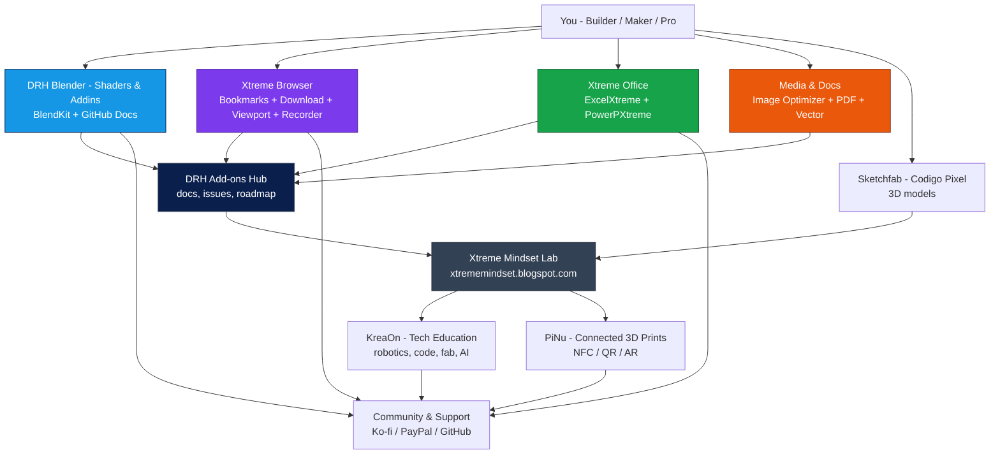

# Paco Salas - DRH - Xtreme Mindset

**Software - Automation - Blender/3D - Browser Extensions - Office Tools - PDF - Vector - Media - Applied AI - Education**

*Tools that remove repetitive work - in Blender, in the browser, in Office, and beyond.*

---

## Ecosystem at a glance

| Area | What you get | Start here |
|---|---|---|
| **Blender - DRH Addins** | 6 released add-ons + shaders, materials, HDRIs - layout, ramps, units, audit, scene inventory | [BlendKit Catalog](https://www.blendkit.com/?query=author_id:205846) - [DRH Hub](https://github.com/pacosalasv/DRH_Addons_Hub) |
| **Browser Extensions** | 4 Xtreme tools - bookmarks, image download, viewport pilot, screen recorder | [Xtreme Tools](#xtreme-browser-extensions) |
| **Office Tools** | ExcelXtreme + PowerPXtreme - Ribbons that save clicks | [Office](#xtreme-office-tools) |
| **Media & Documents** | Image Optimizer Portable, PDF Xtreme, Vector - batch, convert, optimize | [Media](#media-and-documents) |
| **Education & Physical** | KreaOn academy, PiNu connected products, Sketchfab models | [Explore](#explore-more) |

---

## DRH - Blender Addins

> GitHub = docs, support, changelog. Downloads on BlendKit.

| Product | Helps with | Links |
|---|---|---|
| **DRH - Scene Material Inventory** Released - v1.0.0 | Audit materials, shader nodes, images, PBR maps - export a scene report. | [Download](https://www.blendkit.com/asset-gallery-detail/8225a754-32cd-482d-a0d3-84ea3850fc8f/) - [Support](https://github.com/pacosalasv/DRH_Scene_Material_Inventory-Support) |
| **DRH - Color Ramp Studio** Released - v1.1.0 | Build, sample, convert, and clean Color Ramps across Shader, Geo Nodes, Compositor. | [Download](https://www.blendkit.com/asset-gallery-detail/62ac725e-c55e-4e26-9e39-f6b81432d962/) - [Support](https://github.com/pacosalasv/DRH_Color_Ramp_Studio-Support) |
| **DRH - Object Layout Studio Complete** Released - v1.0.0 | Place and align objects with precision - everyday moves plus geometry-aware workflows. | [Download](https://www.blendkit.com/asset-gallery-detail/63177030-cdb4-45ae-8bec-76a3ee48d151/) - [Support](https://github.com/pacosalasv/DRH_Object_Layout_Studio-Support) |
| **DRH - Object Layout Studio Lite** Released - v1.0.0 | Lean layout essentials - align, space, rotate, match transforms. | [Download](https://www.blendkit.com/asset-gallery-detail/0b1494ca-c801-4cbf-9783-46ddbcf0090f/) - [Support](https://github.com/pacosalasv/DRH_Object_Layout_Studio-Support) |
| **DRH - Dual Units & Measurements** Released - v1.1.0 | See metric and imperial side by side - less math when you model to scale. | [Download](https://www.blendkit.com/asset-gallery-detail/6fdca217-16ce-4771-bd1f-3aba38f48858/) - [Support](https://github.com/pacosalasv/DRH_Dual_Units-Support) |
| **DRH - Add-on Manager & Audit** Released - v1.0.0 | Find duplicates, check compatibility, snapshot your setup, export a clean report. | [Download](https://www.blendkit.com/asset-gallery-detail/89fe5b10-df59-4940-b66e-8e8114e9fd53/) - [Support](https://github.com/pacosalasv/DRH_Addons_Audit-Support) |

More in the **[DRH Add-ons Hub](https://github.com/pacosalasv/DRH_Addons_Hub)** and the **[full BlendKit catalog](https://www.blendkit.com/?query=author_id:205846)**.

More DRH roadmap (on hold / planned) - see Hub

- **DRH - Rock Studio** - procedural rocks - on hold, tracked in Hub
- **DRH - Dice Studio** - dice forge - on hold, tracked in Hub
- **DRH - Asset Pipeline Studio** - import/export batch - on hold, tracked in Hub
- **DRH - Mechanical Component Builder** - fasteners and parts - on hold, tracked in Hub
- **DRH - Clock Studio** - custom clocks - on hold, tracked in Hub
- **DRH - Node Toolkit / Smart Cut / Material Inventory / Asset Library Tools / Cloud Studio** - planned, listed in Hub roadmap

Full roadmap: [DRH Add-ons Hub](https://github.com/pacosalasv/DRH_Addons_Hub)

### Shaders & Materials

Procedural shaders and PBR materials for real Blender work - stone, metal, wood, fabric, tile-safe and tweakable in one node group.

[→ Browse DRH materials on BlendKit](https://www.blendkit.com/?query=author_id:205846) - Pair with **Scene Material Inventory** and **Color Ramp Studio** above.

---

## Xtreme Browser Extensions

Built for people who live in the browser long enough to feel every extra click.

| Product | What it does | Access |
|---|---|---|
| **Xtreme Bookmarks** - v1.19  | Turn a large bookmark set into a searchable workspace with tags, favorites, notes, statuses, sidebar, visual folders. | [Support](https://github.com/pacosalasv/Xtreme_Bookmarks-Support) |
| **Xtreme Download All Images** - v1.21  | Find, filter, dedupe, convert, pack images from modern pages - preview and queue. | [Support](https://github.com/pacosalasv/Xtreme_Download_All_Images-Support) |
| **Xtreme Viewport Pilot** - v1.7  | Test responsive layouts across synced viewports with device, network, DPR controls. | [Support](https://github.com/pacosalasv/Xtreme_Viewport_Pilot-Support) |
| **Xtreme Screen Recorder** - v1.10  | Screen + camera + audio, region capture to 4K/60, overlays, local convert, recovery. | [Support](https://github.com/pacosalasv/Xtreme_Screen_Recorder-Support) |

All browser tools are delivered to supporters via private link - see each **Support** page for Ko-fi / PayPal details.

---

## Xtreme Office Tools

One Ribbon to replace dozens of clicks in the tools you already use.

| Product | Why people use it | Access |
|---|---|---|
| **ExcelXtreme** - v1.0  | Cleanup, formulas, names, sheets, flowcharts, protection, focus, layout, export - in one Ribbon. | [Support](https://github.com/pacosalasv/ExcelXtreme-Support) |
| **PowerPXtreme** - v1.0  | Smart Paste, precise layout, Smart Crop, notes, slide care, high-res export. | [Support](https://github.com/pacosalasv/PowerPXtreme-Support) |

---

## Media and Documents

| Product | Why people use it | Access |
|---|---|---|
| **DRH Image Optimizer Portable** - v1.5.2  | Batch optimize with Lossless / Smart / Ultra, metadata control, GUI + CLI, safe replace. | [Support](https://github.com/pacosalasv/DRH_Image_Optimizer_Portable-Support) |
| **PDF Xtreme Studio** - in development | Fast PDF work - merge, split, compress, convert, edit without cloud. | *Coming soon* - [Lab](https://xtrememindset.blogspot.com/) |
| **Vector Xtreme Studio** - in development | Vector editing and conversion for print and web. | *Coming soon* - [Lab](https://xtrememindset.blogspot.com/) |

---

## How this ecosystem connects

This is more than Blender - it is a connected set of tools for people who build, teach, and ship.

**Pick your path:** Blender user -> start on BlendKit. Browser heavy -> Xtreme Bookmarks. Office daily -> ExcelXtreme. Need help -> Support repo for that product. Want overview -> DRH Hub.

---

## Explore more

| Destination | Best for | Link |
|---|---|---|
| **Work with me** | Advisory, automation, product builds | [LinkedIn](https://www.linkedin.com/in/pacosalas) |
| **Support** | Fund fixes, docs, new releases | [Ko-fi](https://ko-fi.com/pacosalasv) - [PayPal](https://www.paypal.com/paypalme/pacosalas?locale.x=en_US&country.x=MX) |
| **DRH downloads** | Shaders, materials, HDRIs, add-ons | [BlendKit](https://www.blendkit.com/?query=author_id:205846) |
| **DRH support** | Docs, Issues, changelog | [DRH Add-ons Hub](https://github.com/pacosalasv/DRH_Addons_Hub) |
| **Xtreme Mindset** | Product lab - browser, Office, media, AI | [Xtreme Mindset](https://xtrememindset.blogspot.com/) |
| **Paco Salas - DRH** | Professional site, bio, projects | [pacosalasv.blogspot.com](https://pacosalasv.blogspot.com/) |
| **Sketchfab** | 3D models & collections | [Sketchfab](https://sketchfab.com/codigopixel/collections) |
| **KreaOn** | Tech education - robotics, code, fab | [KreaOn](https://www.kreaon.com/) |
| **PiNu** | Connected 3D prints with NFC/QR | [PiNu](https://pinu.com.mx/) |
| **GitHub** | Source, support repos, docs | [@pacosalasv](https://github.com/pacosalasv) |

---

## About

I build practical tools that cut repeat work and keep hard workflows under control. Day to day: product building, automation, Blender/3D, browser and Office utilities, media and document tools, and applied AI that stays local and private. Two decades in transformation, PMO, and delivery - now focused on products people actually use.

- **Work together:** [LinkedIn](https://www.linkedin.com/in/pacosalas)
- **Bio & links:** [pacosalasv.blogspot.com](https://pacosalasv.blogspot.com/)
- **Lab notes:** [Xtreme Mindset](https://xtrememindset.blogspot.com/) - [KreaOn](https://www.kreaon.com/) - [PiNu](https://pinu.com.mx/)

---

## Help & feedback

Open an Issue or Discussion in the repo that matches your product (links above). A rating on BlendKit helps others find the tool and tells me what to keep improving.

  
   
  <strong>PayPal?</strong> <a href="https://www.paypal.com/paypalme/pacosalas?locale.x=en_US&country.x=MX">Support via PayPal</a> - <strong>Questions?</strong> <a href="https://github.com/pacosalasv/DRH_Addons_Hub/issues">Open an issue in the Hub</a>

Blender addins - Browser extensions - Office tools - PDF Vector - Paco Salas - DRH - Xtreme Mindset - Mexico - Updated 2026-10
