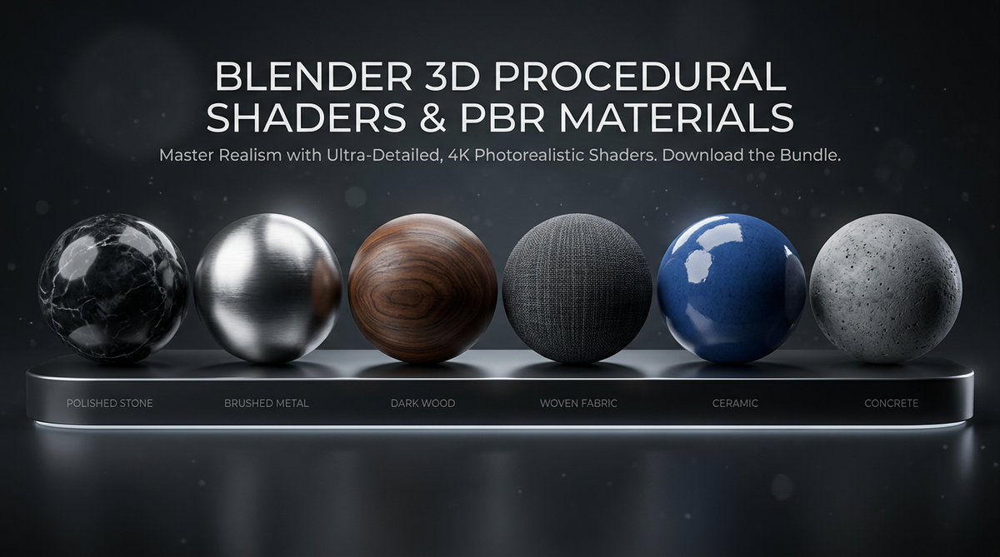
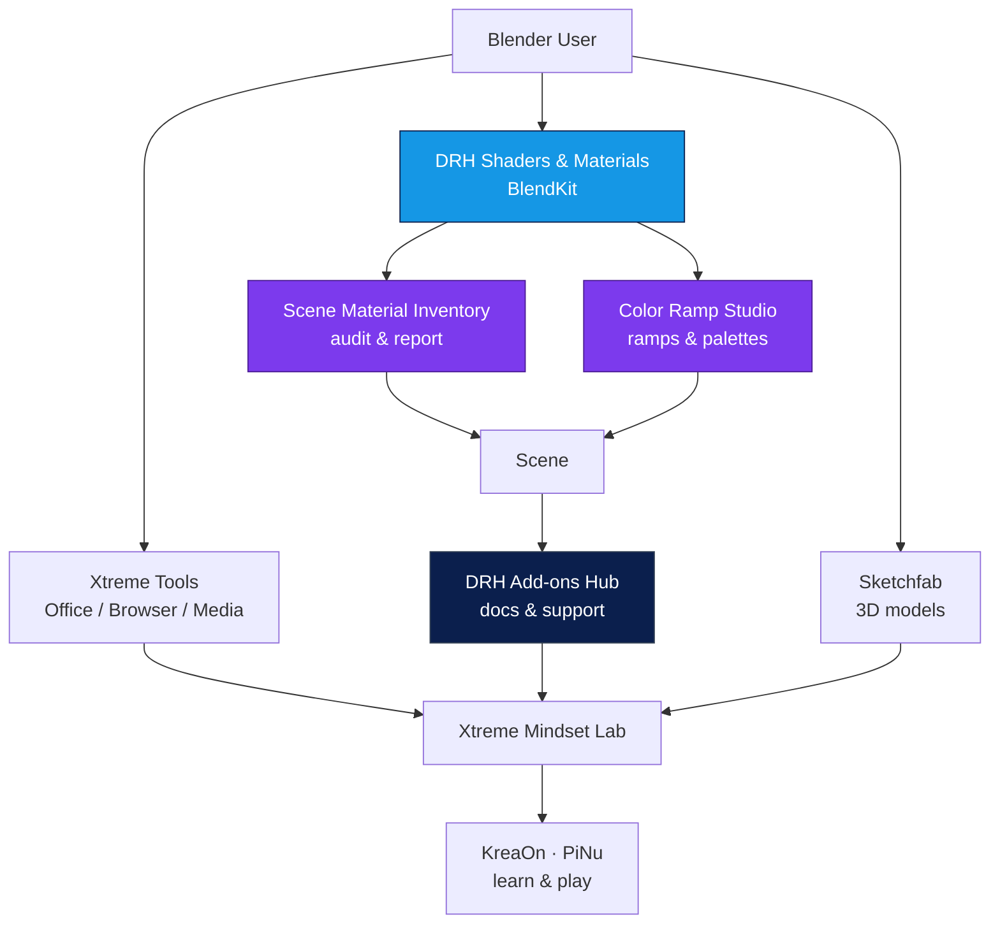

# Paco Salas · DRH — Xtreme Mindset

**Blender shaders & procedural textures · Add-ons that save real time · Tools for people who build things**

*Less setup. More creating.*

---

## Shaders & materials — start here

This is what most people come for. Procedural shaders and PBR materials made for real Blender work — stone, metal, wood, fabric, and surfaces you can tweak without rebuilding your scene.

**On BlendKit:** every material is ready to drag into Blender. GitHub is the manual, changelog, and help desk.

| Preview | Material family | What it does | Get it |
|---|---|---|---|
| `Stone` | **Stone & concrete** — walls, floors, rock with natural variation | Real scale, clean UVs, works in Cycles & Eevee | [Browse on BlendKit](https://www.blendkit.com/?query=author_id:205846%20stone) |
| `Metal` | **Metal & steel** — brushed, painted, worn, reflective | Control roughness, edge wear, fingerprints in one group | [Browse on BlendKit](https://www.blendkit.com/?query=author_id:205846%20metal) |
| `Wood` | **Wood & grain** — oak, walnut, pine with direction control | Grain scale + tint without re-baking | [Browse on BlendKit](https://www.blendkit.com/?query=author_id:205846%20wood) |
| `Fabric` | **Fabric & woven** — canvas, denim, textile weaves | Tile-safe, pattern scale, color way controls | [Browse on BlendKit](https://www.blendkit.com/?query=author_id:205846%20fabric) |

[→ Full DRH material catalog on BlendKit](https://www.blendkit.com/?query=author_id:205846) · [→ How materials are versioned](https://github.com/pacosalasv/DRH_Addons_Hub)

> **Tip:** Pair materials with **Scene Material Inventory** (audit what is in your scene) and **Color Ramp Studio** (build and tweak ramps that drive your shaders). Both are below.

---

## DRH Blender tools

> **GitHub = docs, support, and changelog.** Downloads live on BlendKit.

| Product | Helps with | Links |
|---|---|---|
| **DRH — Scene Material Inventory** Released · v1.0.0 | See every material, shader node, image, and PBR map in your scene. Export a report before you hand off. | [Download](https://www.blendkit.com/asset-gallery-detail/8225a754-32cd-482d-a0d3-84ea3850fc8f/) · [Support](https://github.com/pacosalasv/DRH_Scene_Material_Inventory-Support) |
| **DRH — Color Ramp Studio** Released · v1.1.0 | Build, sample, convert, and clean Color Ramps across Shader, Geometry Nodes, and Compositor. | [Download](https://www.blendkit.com/asset-gallery-detail/62ac725e-c55e-4e26-9e39-f6b81432d962/) · [Support](https://github.com/pacosalasv/DRH_Color_Ramp_Studio-Support) |
| **DRH — Object Layout Studio Complete** Released · v1.0.0 | Place and align objects with precision — everyday moves plus geometry-aware workflows. | [Download](https://www.blendkit.com/asset-gallery-detail/63177030-cdb4-45ae-8bec-76a3ee48d151/) · [Support](https://github.com/pacosalasv/DRH_Object_Layout_Studio-Support) |
| **DRH — Object Layout Studio Lite** Released · v1.0.0 | The essentials for layout — align, space, rotate, match transforms. | [Download](https://www.blendkit.com/asset-gallery-detail/0b1494ca-c801-4cbf-9783-46ddbcf0090f/) · [Support](https://github.com/pacosalasv/DRH_Object_Layout_Studio-Support) |
| **DRH — Dual Units & Measurements** Released · v1.1.0 | Check metric + imperial side by side. Less mental math when you model to scale. | [Download](https://www.blendkit.com/asset-gallery-detail/6fdca217-16ce-4771-bd1f-3aba38f48858/) · [Support](https://github.com/pacosalasv/DRH_Dual_Units-Support) |
| **DRH — Add-on Manager & Audit** Released · v1.0.0 | Find duplicates, check compatibility, snapshot your setup, export a clean report. | [Download](https://www.blendkit.com/asset-gallery-detail/89fe5b10-df59-4940-b66e-8e8114e9fd53/) · [Support](https://github.com/pacosalasv/DRH_Addons_Audit-Support) |

More in the **[DRH Add-ons Hub](https://github.com/pacosalasv/DRH_Addons_Hub)** and the **[full BlendKit catalog](https://www.blendkit.com/?query=author_id:205846)**.

More DRH releases

- **DRH — Rock Studio** — rock and stone building workflows · [Support](https://github.com/pacosalasv/DRH_Rock_Studio-Support)
- **DRH — Dice Studio** — dice and small props with clean topology · [Support](https://github.com/pacosalasv/DRH_Dice_Studio-Support)
- **DRH — Node Toolkit** — shader node helpers · [Support](https://github.com/pacosalasv/DRH_Node_Toolkit-Support)
- **DRH — Smart Cut** — precise cutting workflows · [Support](https://github.com/pacosalasv/DRH_Smart_Cut-Support)
- **DRH — Mechanical Component Builder** — hard-surface parts · [Support](https://github.com/pacosalasv/DRH_Mechanical_Component_Builder-Support)

---

## Xtreme productivity tools

Built for people who live in Office, browsers, and media long enough to feel every extra click.

| Product | Why people use it | Access |
|---|---|---|
| **ExcelXtreme** · v1.0 | One Ribbon for cleanup, formulas, names, sheets, flowcharts, protection, focus, layout, and export. | [Support](https://github.com/pacosalasv/ExcelXtreme-Support) |
| **PowerPXtreme** · v1.0 | Smart Paste, precise layout, Smart Crop, notes, slide care, and high-res export. | [Support](https://github.com/pacosalasv/PowerPXtreme-Support) |
| **DRH Image Optimizer Portable** · v1.5.2 | Batch optimize with Lossless / Smart / Ultra, metadata control, GUI + CLI, safe replace. | [Support](https://github.com/pacosalasv/DRH_Image_Optimizer_Portable-Support) |
| **Xtreme Screen Recorder** · v1.10 | Screen + camera + audio, region capture to 4K/60, overlays, local convert, recovery. | [Support](https://github.com/pacosalasv/Xtreme_Screen_Recorder-Support) |
| **Xtreme Bookmarks** · v1.19 | Tag, favorite, note, and clean a large bookmark set from the sidebar. | [Support](https://github.com/pacosalasv/Xtreme_Bookmarks-Support) |
| **Xtreme Download All Images** · v1.21 | Find, filter, dedupe, convert, and pack images from modern pages. | [Support](https://github.com/pacosalasv/Xtreme_Download_All_Images-Support) |
| **Xtreme Viewport Pilot** · v1.7 | Test responsive layouts across synced viewports with device, network, and DPR controls. | [Support](https://github.com/pacosalasv/Xtreme_Viewport_Pilot-Support) |

Office and browser tools are handed to supporters directly — see each **Support** page for Ko-fi / PayPal and delivery details.

---

## How this ecosystem connects

**Pick a path:** need shaders → start on BlendKit. Need help → open the Support repo for that product. Want to see everything → DRH Add-ons Hub.

---

## 3D models

Selected pixel, voxel, and 3D work lives on **Sketchfab — Código Píxel**.

[→ Browse collections on Sketchfab](https://sketchfab.com/codigopixel/collections)

Need a model for your own project? Support via [Ko-fi](https://ko-fi.com/pacosalasv) or [PayPal](https://www.paypal.com/paypalme/pacosalas?locale.x=en_US&country.x=MX). In your message, include the **model name or URL + the email where you want it**. If I can share it directly, I will send the current build.

---

## About

I build tools that cut repeat work and keep hard workflows under control. Day to day: product building, automation, Blender/3D, Office and browser utilities, and applied AI that stays local and private. Over two decades in transformation, PMO/portfolio, and delivery — now focused on products that people actually use.

- **Work together:** [LinkedIn](https://www.linkedin.com/in/pacosalas) — advisory, automation, product builds
- **Full bio & links:** [pacosalasv.blogspot.com](https://pacosalasv.blogspot.com/)
- **Lab notes:** [Xtreme Mindset](https://xtrememindset.blogspot.com/) · [KreaOn](https://www.kreaon.com/) · [PiNu](https://pinu.com.mx/)

---

## Ecosystem at a glance

| Destination | Best for | Link |
|---|---|---|
| **Work with me** | Advisory, automation, product collabs | [LinkedIn](https://www.linkedin.com/in/pacosalas) |
| **Support** | Fund fixes, docs, and new releases | [Ko-fi](https://ko-fi.com/pacosalasv) · [PayPal](https://www.paypal.com/paypalme/pacosalas?locale.x=en_US&country.x=MX) |
| **DRH downloads** | Shaders, materials, HDRIs, add-ons | [BlendKit](https://www.blendkit.com/?query=author_id:205846) |
| **DRH support** | Docs, Issues, changelog, roadmap | [DRH Add-ons Hub](https://github.com/pacosalasv/DRH_Addons_Hub) |
| **Sketchfab** | 3D models & collections | [Sketchfab](https://sketchfab.com/codigopixel/collections) |
| **KreaOn** | Tech education — robotics, code, fab | [KreaOn](https://www.kreaon.com/) |
| **PiNu** | Connected 3D prints with NFC/QR | [PiNu](https://pinu.com.mx/) |
| **GitHub** | Source, support repos, docs | [@pacosalasv](https://github.com/pacosalasv) |

---

## Help & feedback

Open an Issue or Discussion in the repo that matches your product (links above). A rating on BlendKit helps others find the tool and tells me what to keep improving.

  
   
  <strong>PayPal?</strong> <a href="https://www.paypal.com/paypalme/pacosalas?locale.x=en_US&country.x=MX">Support via PayPal</a> · <strong>Questions?</strong> <a href="https://github.com/pacosalasv/DRH_Addons_Hub/issues">Open an issue in the Hub</a>

Blender shaders · PBR materials · procedural textures · Blender add-ons · Paco Salas · DRH · Xtreme Mindset · Mexico · Updated 2026-10
